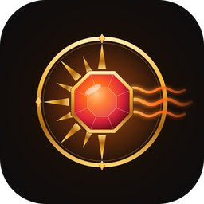
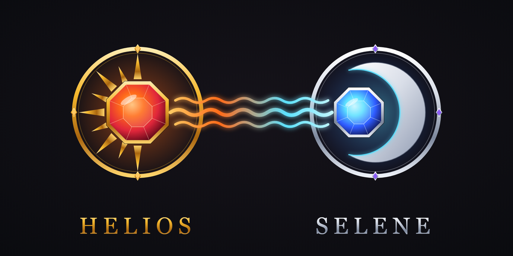

<p align="center">
  
</p>

# Helios

Helios is a self-hosted game stream host for Windows. It streams your desktop and games to
[Selene Game Streaming](https://github.com/eumarcodev/Selene-Game-Streaming) (the Android client of this project) and to
other Moonlight-compatible clients, with hardware encoding on AMD, Intel and NVIDIA GPUs (software encoding is also
available) and a web UI for configuration and pairing.

It inherits from its upstream projects a virtual display (SudoVDA) that matches the client's resolution and frame rate,
per-client permissions, clipboard sync, commands run on client connect/disconnect, and an input-only mode.

Downloads: [Releases](https://github.com/eumarcodev/Helios-Server/releases).

## Lineage and credits

This project is an independent fork. Its names continue a family of names: the host is **Helios** (the sun) and the Android client is **Selene Game Streaming** (the moon), following the lineage below.

<p align="center">
  
</p>

The icons tell the same story: Helios, the sun, emits the stream (orange waves leaving the ruby core), and Selene, the moon, receives it and reflects it (the waves cool into cyan as they reach the sapphire). Sources and the generator live in [`branding/`](branding).

| Project | Role | Name origin | Authors |
|---------|------|-------------|---------|
| [Moonlight](https://github.com/moonlight-stream) | Original open-source client for NVIDIA GameStream | Moon | Cameron Gutman and the Moonlight contributors |
| [Sunshine](https://github.com/LizardByte/Sunshine) | Self-hosted GameStream-compatible host | Sun | Elia Zammuto (original author), then LizardByte and contributors |
| [Apollo](https://github.com/ClassicOldSong/Apollo) | Sunshine fork with virtual display (SudoVDA), per-client permissions and clipboard sync | Greek god of the sun | ClassicOldSong |
| [Artemis (Moonlight Noir)](https://github.com/ClassicOldSong/moonlight-android) | Moonlight Android fork that pairs with Apollo | Greek goddess of the moon | ClassicOldSong |
| [**Helios**](https://github.com/eumarcodev/Helios-Server) | This project, the host (fork of Apollo) | Greek personification of the sun, older than Apollo | Maintained by [eumarcodev](https://github.com/eumarcodev) |
| [**Selene Game Streaming**](https://github.com/eumarcodev/Selene-Game-Streaming) | This project, the Android client (fork of Artemis) | Greek personification of the moon, older than Artemis | Maintained by [eumarcodev](https://github.com/eumarcodev) |

Sunshine and Moonlight pair as sun and moon, Apollo and Artemis as the twin gods, and Helios and Selene go one generation further back, to the Titans they descend from.

The low-latency codec is [PyroWave](https://github.com/Themaister/pyrowave) by Hans-Kristian Arntzen (Themaister), used through the fork [eumarcodev/pyrowave](https://github.com/eumarcodev/pyrowave).

### Thanks

Almost everything here exists because of other people's work, and we are grateful to:

- **ClassicOldSong**, for Apollo, Artemis and SudoVDA, which are the base of this fork.
- **LizardByte** and every Sunshine contributor, and **Elia Zammuto**, for creating Sunshine.
- **Cameron Gutman** and the **Moonlight** contributors, for the client, the streaming protocol work and `moonlight-common-c`.
- **Hans-Kristian Arntzen (Themaister)**, for PyroWave.
- Everyone who reported issues, sent patches or documented the quirks of game streaming along the way.

This fork keeps the original license (GPLv3) and the copyright notices of the upstream projects. The upstream history is preserved in this repository's git log.

It is not affiliated with LizardByte, Moonlight, Apollo or Artemis. Compatibility with other Sunshine-based hosts' clients is kept where possible, but is not guaranteed.

## What changed since the fork

**PyroWave codec** (intra-only wavelet codec in Vulkan compute shaders, for the lowest latency on a local network):

- Negotiated as a video format next to H.264, HEVC and AV1, encoded from the D3D11 capture on the GPU and sent over the RTP video channel; on by default.
- Stable rate control, so still areas do not flicker; no bitrate reserved for FEC.
- "Sharper still screen": higher quality when the picture stops moving.
- Honors the packet size and maximum frame size asked by the client, and takes a new frame budget from the client during the session (Helios extension `0x3003`).
- Reports the host encode latency and the Helios version to the client's performance overlay.
- PyroWave tab in the web UI (packet size, minimum frame size, GPU priority) and a synthetic test-pattern session the client can request for setup and benchmarks.

**Streaming**

- Audio sent in the video QoS class by default (`audio_qos`), which removed the audio stalls seen on Wi-Fi.
- Only one device streams at a time; another device is told the host is in use.
- Fixes: pairing use-after-free, refresh rate remapping, AMD AMF encoder hang at session end, build with OpenSSL 4.

**Product and releases**

- Renamed to Helios everywhere (installer, service, firewall rule, web UI, executables `helios.exe` and `heliossvc.exe`, config files `helios.conf` and `helios_state.json`); upgrading an older Helios install keeps the config, credentials and pairings.
- Release candidates on every merge, stable releases, and a web UI update check that follows the chosen channel.

The setup Helios and Selene are tuned on, with measured results and recommended settings, is in [docs/streaming-guide.md](docs/streaming-guide.md).

## Building

Helios is developed and tested on Windows, built with MSYS2 UCRT64 (GCC, CMake, Ninja). Linux and macOS code paths are inherited but not built or tested in this fork.

Fetch the submodules recursively, except `third-party/pyrowave`: Granite, inside it, has many nested submodules that are not needed, so fetch PyroWave alone and let its script check out only the Granite parts the build uses (`.github/workflows/build.yml` does the same).

```bash
git submodule update --init third-party/pyrowave
bash third-party/pyrowave/checkout_granite.sh
git -c submodule.third-party/pyrowave.update=none submodule update --init --recursive
export PROCESSOR_ARCHITECTURE=AMD64      # needed for the prebuilt FFmpeg path
cmake -B build -G Ninja -S . -DBUILD_TESTS=ON
ninja -C build
build/tests/test_helios                  # unit tests
cpack -G NSIS --config build/CPackConfig.cmake   # installer; -G ZIP for the portable package
```

The web UI target needs the Windows `node.exe` on `PATH`. More details in [docs/building.md](docs/building.md).

## License

GPLv3
